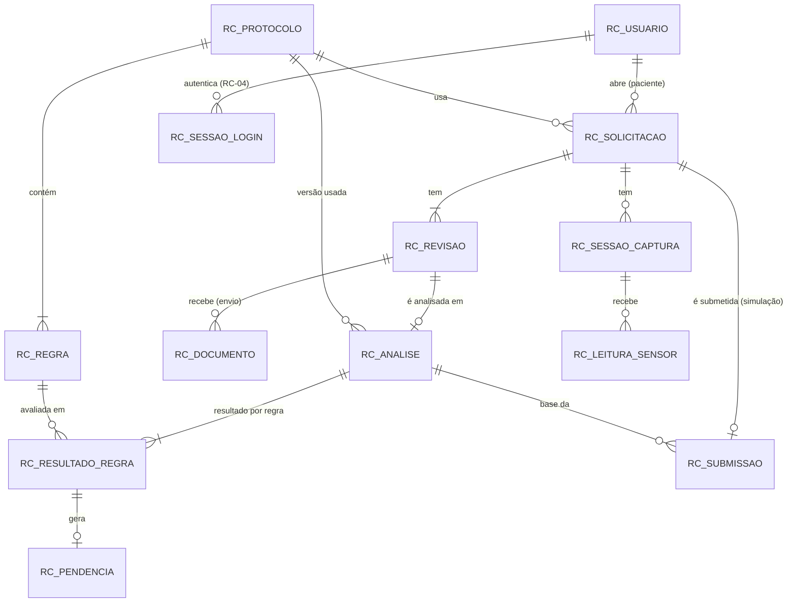

# Modelo de dados (RC-03, com a tabela de sessões da RC-04)

Banco **Oracle 19c** da faculdade. Todas as tabelas têm o prefixo `RC_` porque o esquema é compartilhado com outros trabalhos. Os scripts estão em [`database/scripts/`](../database/scripts/README.md); a origem do desenho (decisões e alternativas) está em [`specs/003-modelo-banco-sql/`](../specs/003-modelo-banco-sql/data-model.md). Nomes de estados, resultados e regras coincidem com [api/estados-e-revisoes.md](api/estados-e-revisoes.md) e [protocolo-academico.md](protocolo-academico.md). Dados somente sintéticos; protocolo fictício.

## Diagrama entidade-relacionamento

## Como ler o modelo

- **A paciente é uma conta** (`RC_USUARIO` com `PERFIL = 'PACIENTE'`); não existe tabela de paciente separada.
- **Revisão é uma entidade** (`RC_REVISAO`, chave composta pedido + número). Para saber o que mudou entre a revisão 1 e a 2: compare os documentos (`REVISAO_ENVIO <= n` e `REVISAO_REMOCAO` nula ou `> n`) e as análises de cada revisão. Substituir ou remover um arquivo **não apaga** o histórico.
- **Versão do protocolo usada** fica em `RC_ANALISE.PROTOCOLO_ID` (a análise guarda a versão com que foi feita).
- **Uma análise vigente por pedido**: índice único funcional `RC_ANALISE_VIGENTE_UK`.
- **Pendência** só existe para resultado `PENDENTE` ou `NAO_VERIFICAVEL` e o tipo dela precisa ser igual ao resultado da mesma regra na mesma análise (chave estrangeira composta). `NAO_VERIFICAVEL` se distingue de ausência pelo `TIPO`.

## Dicionário

Convenções: `PK` chave primária · `FK` estrangeira · `UK` única · `NN` não nulo. Texto em `VARCHAR2(n CHAR)`; instantes em `TIMESTAMP WITH TIME ZONE` (UTC); booleanos em `NUMBER(1)` com `CHECK` 0/1; chaves numéricas geradas por `IDENTITY`.

### RC_USUARIO
`ID` (PK) · `EMAIL` (UK, NN) · `NOME` (NN) · `SENHA_HASH` (NN; somente hash BCrypt custo 12, 60 caracteres) · `PERFIL` (NN; `PACIENTE`/`ADMINISTRADOR`) · `ATIVO` (NN; 0/1) · `CRIADO_EM` (NN).

### RC_PROTOCOLO
`ID` (PK) · `IDENTIFICADOR` (NN) · `VERSAO` (NN) · `LOCALIDADE` · `ESPECIALIDADE` · `AVISO_FICTICIO` (NN) · `ATIVO` (NN; 0/1) · `CRIADO_EM`. UK (`IDENTIFICADOR`, `VERSAO`).

### RC_REGRA
`ID` (PK) · `PROTOCOLO_ID` (FK, NN) · `CODIGO` (NN) · `DESCRICAO` · `EVIDENCIA_EXIGIDA` · `NATUREZA` (`OBRIGATORIA`/`CONDICIONAL`) · `CONDICAO_APLICACAO` · `MENSAGEM` · `RESPONSAVEL` (`PACIENTE`/`UNIDADE_EMISSORA`) · `ORDEM`. UK (`PROTOCOLO_ID`, `CODIGO`). `CHECK`: regra condicional exige `CONDICAO_APLICACAO`.

### RC_SOLICITACAO
`ID` (PK) · `PACIENTE_ID` (FK → RC_USUARIO, NN) · `PROTOCOLO_ID` (FK, NN) · `ESTADO` (NN; os 7 estados) · `REVISAO_ATUAL` (NN, ≥ 1) · `CRIADA_EM` · `ATUALIZADA_EM`.

### RC_REVISAO
PK composta (`SOLICITACAO_ID` FK, `NUMERO` ≥ 1) · `MOTIVO` (`CRIACAO`, `DOCUMENTO_ENVIADO`, `DOCUMENTO_SUBSTITUIDO`, `DOCUMENTO_REMOVIDO`, `CONFERENCIA_ALTERADA`, `PROTOCOLO_ALTERADO`) · `CRIADA_EM`. `PROTOCOLO_ALTERADO` (RC-07) registra a troca de serviço de um rascunho; bancos criados antes da RC-07 precisam do script aditivo `06_motivo_revisao_protocolo.sql`.

### RC_DOCUMENTO
`ID` (PK) · (`SOLICITACAO_ID`, `REVISAO_ENVIO`) FK → RC_REVISAO · `REVISAO_REMOCAO` (nula enquanto ativo; FK composta; `CHECK` > `REVISAO_ENVIO`) · `NOME_ORIGINAL` · `TIPO` (`PDF`/`JPEG`/`PNG`) · `TAMANHO_BYTES` (1 a 5 242 880) · `PAGINAS` (≥ 1, ≤ 5 para PDF) · `CAMINHO_INTERNO` (UK; nome seguro gerado pelo sistema, nunca o nome do usuário) · `ENVIADO_EM`.

### RC_ANALISE
`ID` (PK) · (`SOLICITACAO_ID`, `REVISAO`) FK → RC_REVISAO e UK · `PROTOCOLO_ID` (FK, NN) · `RESULTADO_GERAL` (`COM_PENDENCIAS`/`REQUER_CONFERENCIA`/`SEM_PENDENCIAS_IDENTIFICADAS`) · `VIGENTE` (0/1; no máximo um por pedido) · `SIMULADO` (sempre 1) · `RESUMO_TEXTO` · `RESUMO_ORIGEM` (`ADAPTADOR_MOCKADO`/`PADRAO`) · `CRIADA_EM`.

### RC_RESULTADO_REGRA
PK composta (`ANALISE_ID` FK, `REGRA_ID` FK) · `RESULTADO` (`ATENDE`/`PENDENTE`/`NAO_VERIFICAVEL`/`NAO_APLICAVEL`). UK adicional (`ANALISE_ID`, `REGRA_ID`, `RESULTADO`) usada pela pendência.

### RC_PENDENCIA
`ID` (PK) · `ANALISE_ID`, `REGRA_ID` (UK) · `TIPO` (`PENDENTE`/`NAO_VERIFICAVEL`) · FK composta (`ANALISE_ID`, `REGRA_ID`, `TIPO`) → RC_RESULTADO_REGRA (tipo igual ao resultado) · `MENSAGEM` · `RESPONSAVEL`.

### RC_SESSAO_CAPTURA
`ID` (PK) · `SOLICITACAO_ID` (FK, NN) · `INICIADA_EM` · `ENCERRADA_EM` (≥ início).

### RC_LEITURA_SENSOR
`ID` (PK) · `SESSAO_ID` (FK, NN) · `TIPO` (`LUMINOSIDADE`/`DISTANCIA`) · `VALOR` (`NUMBER(12,3)`) · `UNIDADE` (`LUX` para luminosidade, `CM` para distância) · `MEDIDA_EM` · `RECEBIDA_EM`.

### RC_SESSAO_LOGIN (RC-04, criada por `05_sessao_login.sql`)
`ID` (PK) · `USUARIO_ID` (FK, NN) · `TOKEN_HASH` (UK, NN; SHA-256 do token em hexadecimal minúsculo, 64 caracteres; nunca o token) · `CRIADA_EM` (NN) · `EXPIRA_EM` (NN; posterior a `CRIADA_EM`) · `ENCERRADA_EM` (nula enquanto a sessão está aberta). Sessão válida: não encerrada, não expirada e conta com `ATIVO = 1`. **Não confundir** com `RC_SESSAO_CAPTURA`: `RC_SESSAO_LOGIN` é a autenticação da paciente na API; `RC_SESSAO_CAPTURA` agrupa as leituras dos sensores simulados de um pedido.

### RC_SUBMISSAO
`ID` (PK) · `SOLICITACAO_ID` (FK, UK: uma por pedido) · `ANALISE_ID` (FK) · `REFERENCIA` (UK) · `SIMULADA` (sempre 1) · `SUBMETIDA_EM`. Não é envio a nenhuma fila real do SUS.

## Cardinalidades

- Usuário 1—N Solicitação · Protocolo 1—N Regra, 1—N Solicitação e 1—N Análise.
- Solicitação 1—N Revisão (mínimo 1) · Revisão 1—N Documento (envio) · Revisão 1—0..1 Análise.
- Análise 1—N Resultado de regra (um por regra) · Resultado de regra 1—0..1 Pendência.
- Solicitação 1—N Sessão de captura · Sessão 1—N Leitura · Solicitação 1—0..1 Submissão.
- Usuário 1—N Sessão de login (várias sessões simultâneas por conta; encerrar uma não afeta as outras).

## O que o banco garante e o que fica para a API

- **Banco:** valores permitidos, unicidades (e-mail, código da regra por versão, resultado por regra por análise, revisão por pedido, vigência única, submissão única), referências, tipo da pendência igual ao do resultado, limites de arquivo e unidade de sensor coerente com o tipo.
- **API (RC-05 em diante):** autorização por recurso, implementada como mecanismo na RC-05 e aplicada por cada história de negócio (o banco não impede a paciente A de apontar para o pedido da paciente B), transições de estado, consistência de `REVISAO_ATUAL` com a revisão mais recente, resultado geral derivado dos resultados por regra, classificação de leitura "antiga" e faixas dos sensores.
- **Arquivos (RC-06):** a conferência (`ConferenciaDeArquivo`) produz exatamente os valores que `RC_DOCUMENTO` aceita: `TIPO` (PDF/JPEG/PNG), `TAMANHO_BYTES` (1 a 5 242 880), `PAGINAS` (imagem = 1; PDF ≤ 5) e `CAMINHO_INTERNO` (o `IdInterno` de 32 caracteres hexadecimais, nunca caminho absoluto nem o nome enviado); `NOME_ORIGINAL` recebe o nome saneado para exibição. Nenhuma tabela, coluna ou script novo; a linha é gravada pela história de envio depois de guardar o arquivo.
- **Mudanças futuras do esquema:** sempre por novos scripts numerados e aditivos; nunca por recriação automática.
