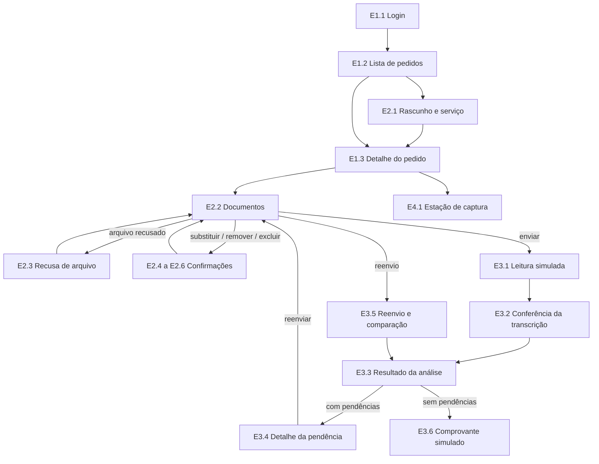

# Mapa de percursos

> Como as telas se ligam. É um mapa em texto (sem protótipo executável). Os IDs são os quadros de [INDEX.md](INDEX.md). Dados: [dados-ficticios.md](dados-ficticios.md). **Estado:** percursos planejados; os quadros ainda não foram desenhados.

## Percurso principal da demonstração (paciente A)
1. **E1.1** Login (Padrão) → entrar → **E1.2** Lista de pedidos.
2. **E1.2** → "Novo pedido" → **E2.1** Rascunho e serviço → "Salvar rascunho" → **E1.3** Detalhe (`RASCUNHO`).
3. **E1.3** → "Anexar documentos" → **E2.2** Documentos → anexar `encaminhamento-sintetico.pdf` e `cartao-sus-sintetico.jpg`.
4. Envio recusado → **E2.3** (uma das sete recusas) → "Escolher outro arquivo" → **E2.2**.
5. **E2.2** → enviar para conferência → **E3.1** Leitura simulada → **E1.3** (`PROCESSANDO`) → **E3.2** Conferência da transcrição (se `REQUER_CONFERENCIA`).
6. **E3.2** → "Concluir conferência" → **E3.3** Resultado (`COM_PENDENCIAS`) → "Ver detalhes" → **E3.4** Detalhe da pendência.
7. **E3.4** (reenviar) → **E2.2** → substituir documento (**E2.4**) → **E3.5** Reenvio (antes do novo resultado) → **E3.5** Comparação.
8. **E3.3** (`SEM_PENDENCIAS_IDENTIFICADAS`) → "Concluir simulação" → **E3.6** Comprovante.

## Condições globais (valem em qualquer tela privada)
| Condição | Para onde vai |
|---|---|
| 401 (sessão expirada ou token inválido) | **E1.4** Sessão expirada → **E1.1** Login |
| 403 (sem permissão) | **E1.5** Sem permissão → tela anterior |
| 404 (item não encontrado) | **E1.3** "Não encontrado" → **E1.2** |
| Sem conexão ou tempo esgotado | **E4.3** (campos preservados; "tentar novamente") |
| Erro genérico | faixa de erro do catálogo (F2) com "tentar novamente" |

## Percurso do administrador
**E1.1** Login (conta administradora) → **E4.2** Protocolo e indicadores (Padrão). Uma paciente que tenta abrir **E4.2** vê **E4.2** "Sem permissão". O administrador não abre nenhuma tela de documento ou pedido individual (se tentar, vê **E1.5**).

## Percurso dos sensores
No fluxo de anexar fotos (**E2.2**), a pessoa pode abrir **E4.1** Estação de captura: normal → fora da faixa (aviso de ajuste) → recuperada; leitura antiga mostra "Desatualizada"; sem sensores mostra "Indisponíveis" e **não bloqueia** o envio nem o salvamento.

## Percurso de conexão ruim
Qualquer envio ou salvamento que falhe por rede → **E4.3** (tempo esgotado ou sem conexão) → "Tentar novamente" → volta à tela de origem com os campos preservados. Nenhum envio é declarado concluído sem confirmação.
