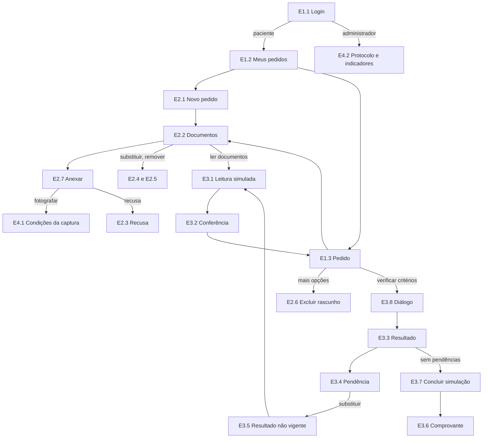

# Mapa de percursos

> Como as telas se ligam, conforme [specs/014-fluxo-telas-app/spec.md](../../specs/014-fluxo-telas-app/spec.md) (fluxo que acompanha o backend). IDs dos quadros: [specs/014-fluxo-telas-app/contracts/inventario-quadros.md](../../specs/014-fluxo-telas-app/contracts/inventario-quadros.md). Dados: [dados-ficticios.md](dados-ficticios.md). Mapa em texto, sem protótipo executável.
>
> **Situação em 14/11/2026:** faixa RC-36 desenhada (E1.1 a E1.5, 25 quadros). RC-37, RC-38 e RC-39 planejadas.

## Percurso de entrada (RC-36) — desenhado

1. **E1.1** Login → "Entrar" → paciente vai a **E1.2** Meus pedidos; administrador vai a **E4.2**.
2. **E1.2** mostra o pedido mais recente que pede ação em destaque (Pedido 4, rascunho) e os demais em lista (Pedidos 2 e 1); "Novo pedido" → **E2.1**; "Sair" → **E1.1**.
3. Tocar um pedido → **E1.3** Pedido: superfície "Próximo passo" com a ação principal da situação (tabela FR-012) e as seções Documentos, Leitura e conferência e Resultado.
4. Em rascunho, "Mais opções" no cabeçalho → "Trocar serviço" (**E2.1**) ou "Excluir rascunho" (**E2.6**).

| Situação em E1.3 | Ação principal → destino |
|---|---|
| Rascunho sem documentos | "Anexar documentos" → **E2.2** |
| Rascunho sem leitura atual | "Ler documentos" → **E3.1** |
| Rascunho a conferir | "Conferir leitura" → **E3.2** (apoio: "Verificar critérios" → **E3.8**) |
| Rascunho pronto para verificar | "Verificar critérios" → **E3.8** |
| Em verificação | "Atualizar" → **E1.3** |
| Confira a leitura | "Ver o que conferir" → **E3.3** |
| Com pendências | "Ver pendências" → **E3.3** |
| Sem pendências identificadas | "Concluir simulação" → **E3.7** |
| Falha na verificação | "Tentar de novo" → **E1.3** Em verificação |
| Resultado não vigente | "Ler documentos de novo" → **E3.1** |
| Simulação concluída | "Ver comprovante" → **E3.6** |

## Percurso principal da demonstração (planejado)

1. **E1.2** → "Novo pedido" → **E2.1** → "Criar rascunho" → **E2.2** do Pedido 5.
2. **E2.2** → "Anexar documento" → **E2.7** tipo → origem ("Fotografar" passa por **E4.1**) → linha "Enviando…" → "Enviado"; recusa → **E2.3**.
3. **E2.2** → "Ler documentos" → **E3.1** (SIMULADO) → **E3.2** Conferência, um documento por vez → "Concluir conferência" → **E1.3**.
4. **E1.3** → "Verificar critérios" → **E3.8** → **E1.3** Em verificação → **E3.3** Resultado.
5. **E3.3** Com pendências → **E3.4** Detalhe da pendência → "Já tenho uma nova versão" / "Substituir arquivo" (**E2.7** + **E2.4**) → **E3.5** resultado não vigente → "Ler documentos de novo" → **E3.1** → **E3.2** → **E3.8** → **E3.3** com comparação.
6. **E3.3** Sem pendências identificadas → **E3.7** → **E3.6** Comprovante (`SIM-2026-0001`).

## Condições globais (qualquer tela privada)

| Condição | Para onde vai |
|---|---|
| 401 (sessão expirada) | **E1.4** Sessão expirada → **E1.1** |
| 403 (perfil sem permissão) | **E1.5** Sem permissão → tela anterior |
| 404 (inexistente ou de outra paciente; mesma resposta) | **E1.3** Não encontrado → **E1.2** |
| Sem conexão ou tempo esgotado | **E4.3** (o que foi digitado é mantido; diz se é preciso escolher o arquivo de novo) |
| Erro do servidor | `Retorno/Erro` com "Tentar de novo" |

## Administrador
**E1.1** (conta de coordenação) → **E4.2** Protocolo e indicadores, só dados agregados; "Sair" → **E1.1**. Telas de paciente respondem **E1.5**.

## Limitação registrada (backend, RC-16)
Depois da primeira verificação, o backend não aceita documento novo; a correção é sempre substituir ou remover. A tela explica isso em **E3.4** "Documento ausente".
