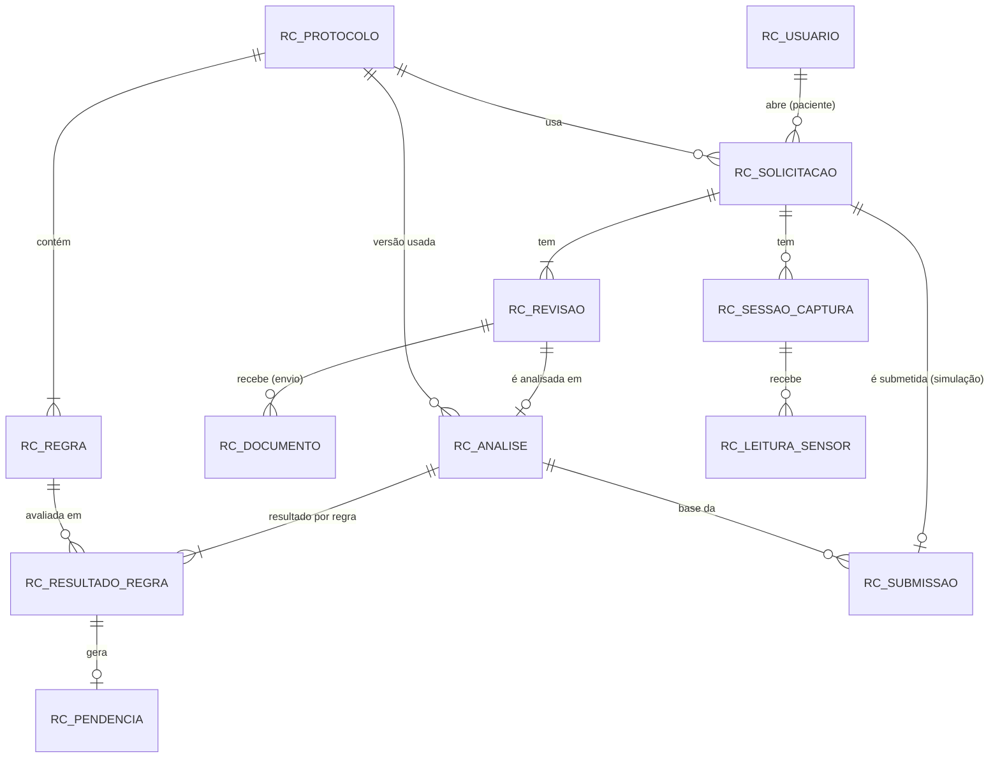

# Modelo de dados — RC-03

Oracle 19c, tabelas com prefixo `RC_`. Decisões em [research.md](research.md). Nomes de estados e resultados iguais a `docs/api/estados-e-revisoes.md` e `docs/protocolo-academico.md`.

## Diagrama entidade-relacionamento

## Dicionário (resumo)

Convenções: `PK` chave primária, `FK` estrangeira, `UK` única, `NN` não nulo. Texto em `VARCHAR2(n CHAR)`, instantes em `TIMESTAMP WITH TIME ZONE` (UTC), booleanos em `NUMBER(1)` com CHECK 0/1.

### RC_USUARIO
`ID` (PK, identity) · `EMAIL` (UK, NN) · `NOME` (NN) · `SENHA_HASH` (NN, BCrypt ≈ 60 caracteres) · `PERFIL` (NN, CHECK PACIENTE/ADMINISTRADOR) · `ATIVO` (NN, 0/1) · `CRIADO_EM` (NN). A paciente é uma conta com `PERFIL = 'PACIENTE'`.

### RC_PROTOCOLO
`ID` (PK) · `IDENTIFICADOR` (NN) · `VERSAO` (NN) · `LOCALIDADE` · `ESPECIALIDADE` · `AVISO_FICTICIO` (NN) · `ATIVO` (NN, 0/1) · `CRIADO_EM`. UK (`IDENTIFICADOR`, `VERSAO`).

### RC_REGRA
`ID` (PK) · `PROTOCOLO_ID` (FK, NN) · `CODIGO` (NN) · `DESCRICAO` · `EVIDENCIA_EXIGIDA` · `NATUREZA` (CHECK OBRIGATORIA/CONDICIONAL) · `CONDICAO_APLICACAO` · `MENSAGEM` · `RESPONSAVEL` (CHECK PACIENTE/UNIDADE_EMISSORA) · `ORDEM`. UK (`PROTOCOLO_ID`, `CODIGO`). CHECK: regra condicional exige `CONDICAO_APLICACAO` não nula.

### RC_SOLICITACAO
`ID` (PK) · `PACIENTE_ID` (FK → RC_USUARIO, NN) · `PROTOCOLO_ID` (FK, NN) · `ESTADO` (NN, CHECK 7 valores) · `REVISAO_ATUAL` (NN, ≥ 1) · `CRIADA_EM` · `ATUALIZADA_EM`.

### RC_REVISAO
PK composta (`SOLICITACAO_ID` FK, `NUMERO` ≥ 1) · `CRIADA_EM` · `MOTIVO` (CHECK: CRIACAO, DOCUMENTO_ENVIADO, DOCUMENTO_SUBSTITUIDO, DOCUMENTO_REMOVIDO, CONFERENCIA_ALTERADA). A revisão atual da solicitação deve existir aqui (a API garante; o teste verifica).

### RC_DOCUMENTO
`ID` (PK) · `SOLICITACAO_ID` (NN) · `REVISAO_ENVIO` (NN) · `REVISAO_REMOCAO` (nula enquanto ativo; CHECK > `REVISAO_ENVIO`) · `NOME_ORIGINAL` · `TIPO` (CHECK PDF/JPEG/PNG) · `TAMANHO_BYTES` (CHECK 1 a 5242880) · `PAGINAS` (CHECK ≥ 1, ≤ 5 para PDF) · `CAMINHO_INTERNO` (NN, nome seguro fora de área pública; nunca o nome do usuário) · `ENVIADO_EM`. FK composta (`SOLICITACAO_ID`, `REVISAO_ENVIO`) → RC_REVISAO.

### RC_ANALISE
`ID` (PK) · `SOLICITACAO_ID`, `REVISAO` (NN; FK composta → RC_REVISAO; UK (`SOLICITACAO_ID`, `REVISAO`)) · `PROTOCOLO_ID` (FK, NN — versão usada) · `RESULTADO_GERAL` (CHECK 3 valores) · `VIGENTE` (0/1; índice único funcional: no máximo uma vigente por pedido) · `SIMULADO` (NN, CHECK = 1) · `RESUMO_TEXTO` · `RESUMO_ORIGEM` (CHECK ADAPTADOR_MOCKADO/PADRAO) · `CRIADA_EM`.

### RC_RESULTADO_REGRA
PK composta (`ANALISE_ID` FK, `REGRA_ID` FK) · `RESULTADO` (NN, CHECK ATENDE/PENDENTE/NAO_VERIFICAVEL/NAO_APLICAVEL). Garante um resultado por regra por análise. UK adicional (`ANALISE_ID`, `REGRA_ID`, `RESULTADO`) para a pendência referenciar o tipo exato.

### RC_PENDENCIA
`ID` (PK) · `ANALISE_ID`, `REGRA_ID` (NN; UK) · `TIPO` (NN, CHECK PENDENTE/NAO_VERIFICAVEL); FK composta (`ANALISE_ID`, `REGRA_ID`, `TIPO`) → UK (`ANALISE_ID`, `REGRA_ID`, `RESULTADO`) de RC_RESULTADO_REGRA, de modo que o tipo da pendência coincide com o resultado da regra · `MENSAGEM` (NN) · `RESPONSAVEL` (CHECK PACIENTE/UNIDADE_EMISSORA). `NAO_VERIFICAVEL` se distingue de ausência pelo `TIPO`.

### RC_SESSAO_CAPTURA
`ID` (PK) · `SOLICITACAO_ID` (FK, NN) · `INICIADA_EM` (NN) · `ENCERRADA_EM`.

### RC_LEITURA_SENSOR
`ID` (PK) · `SESSAO_ID` (FK, NN) · `TIPO` (CHECK LUMINOSIDADE/DISTANCIA) · `VALOR` (`NUMBER(12,3)`, NN) · `UNIDADE` (CHECK LUX com LUMINOSIDADE e CM com DISTANCIA) · `MEDIDA_EM` (NN) · `RECEBIDA_EM` (NN).

### RC_SUBMISSAO
`ID` (PK) · `SOLICITACAO_ID` (FK, UK) · `ANALISE_ID` (FK, NN) · `REFERENCIA` (UK, NN) · `SIMULADA` (CHECK = 1) · `SUBMETIDA_EM`. Uma por pedido.

## Cardinalidades
- Usuário 1—N Solicitação; Protocolo 1—N Regra e 1—N Solicitação e 1—N Análise.
- Solicitação 1—N Revisão (mínimo 1); Revisão 1—N Documento (envio); Revisão 1—0..1 Análise.
- Análise 1—N Resultado de regra (um por regra); Resultado de regra 1—0..1 Pendência.
- Solicitação 1—N Sessão de captura; Sessão 1—N Leitura; Solicitação 1—0..1 Submissão.

## Regras que o banco garante e as que ficam para a API
- **Banco:** valores permitidos, unicidades, referências, vigência única, uma submissão por pedido, limites de tamanho de arquivo e unidade de sensor coerente com o tipo.
- **API:** autorização por recurso, transições de estado, consistência de `REVISAO_ATUAL` com a revisão mais recente, resultado geral derivado dos resultados por regra e "antiga" para leituras.
